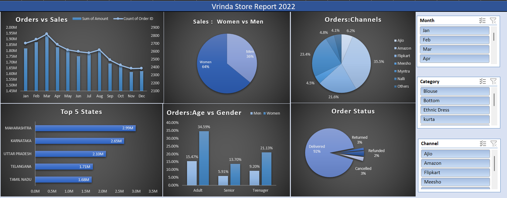

# Vrinda Store Sales Analysis (2022)

## Project Overview
An interactive Excel dashboard analyzing Vrinda Store's 2022 sales data to identify trends in sales performance and customer behavior.

## Tools Used
- Microsoft Excel
- Pivot Tables
- Pivot Charts
- Slicers
- Data Visualization

## Dashboard Preview

## Key Analysis

### 1. Orders vs Sales
Analyzes monthly sales revenue and order volume throughout the year.

### 2. Sales by Gender
Compares sales contributions from male and female customers.

### 3. Orders by Sales Channel
Examines order distribution across different e-commerce platforms.

### 4. Top 5 States
Identifies the five highest-performing states by sales.

### 5. Age Group and Gender
Compares sales patterns across customer age groups and gender.

### 6. Order Status
Analyzes delivered, cancelled, returned, and refunded orders.

## Interactive Features
The dashboard includes slicers for:
- Month
- Category
- Channel

These allow users to filter the data and explore different sales segments.

## Key Findings
- Women account for 64% of sales.
- Maharashtra is the highest-performing state in the displayed analysis.
- Delivered orders account for 92% of orders in the displayed analysis.

## Business Recommendations

Based on the dashboard analysis, the following actions could be explored:

- **Targeted Marketing:** Develop targeted campaigns for customer segments contributing significantly to sales, while exploring opportunities to increase engagement among other segments.

- **Regional Growth:** Investigate the factors driving high sales in Maharashtra and other top-performing states. Apply successful strategies to underperforming regions where appropriate.

- **Sales Channel Optimization:** Compare sales performance across Amazon, Flipkart, Myntra, and other channels to identify opportunities for improving revenue and order volume.

- **Seasonal Planning:** Use monthly sales trends to plan promotional campaigns, inventory, and marketing budgets around periods of higher demand.

- **Customer Segmentation:** Analyze purchasing patterns across age groups and genders to develop more relevant product recommendations and marketing strategies.

- **Order Fulfillment:** Investigate cancelled, returned, and refunded orders to identify potential improvements in customer experience and operational efficiency.

## Conclusion

This project demonstrates how Microsoft Excel can transform raw sales data into an interactive dashboard for monitoring business performance, understanding customer behavior, and identifying opportunities for further investigation.

## Key Learnings
- Data analysis and visualization using Excel.
- Creating Pivot Tables and Pivot Charts.
- Building interactive dashboards using slicers.
- Presenting sales data for business analysis.

## Project Files

- [📊 Download Excel Workbook](Vrinda_Store_Analysis.xlsx)
- [🖼️ View Dashboard Image](Dashboard.png)
